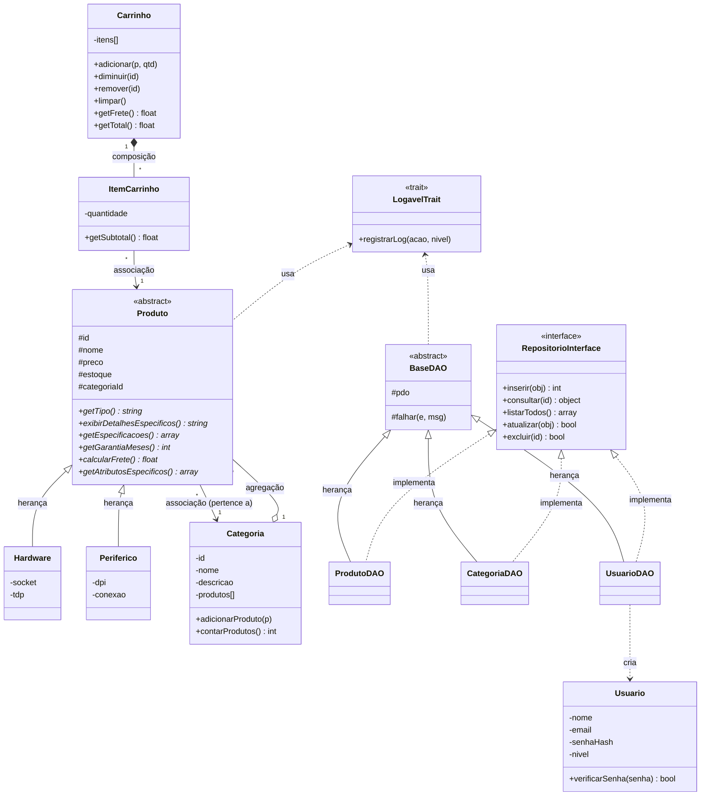
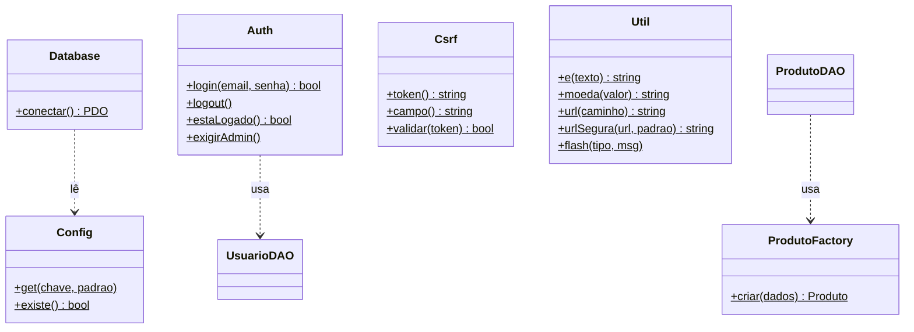
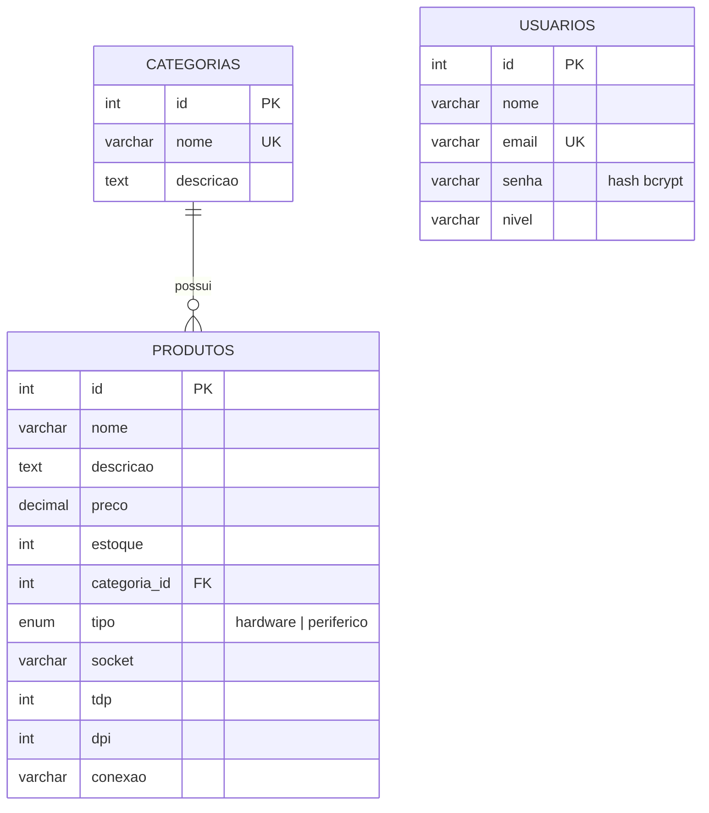

# Diagramas do ByteStore

Os diagramas estão em **Mermaid** (o GitHub desenha sozinho ao abrir este arquivo).
Para entregar como imagem, cole o código em https://mermaid.live e exporte em PNG ou SVG.
O arquivo `mermaid-diagram.png` (nesta pasta) mostra o modelo principal: produtos, categoria, carrinho, DAOs, interface e trait.

## Diagrama de classes (modelo principal)

## Classes de apoio

## Modelo entidade-relacionamento (banco de dados)

## Onde cada relacionamento está no código

| Relacionamento | Onde |
|---|---|
| Associação | `Produto::$categoria` (`app/classes/Produto.php`) e `ItemCarrinho::$produto` |
| Agregação | `Categoria::$produtos` e `adicionarProduto()` (`app/classes/Categoria.php`) |
| Composição | `Carrinho` cria e controla os `ItemCarrinho` (`app/classes/Carrinho.php`) |
